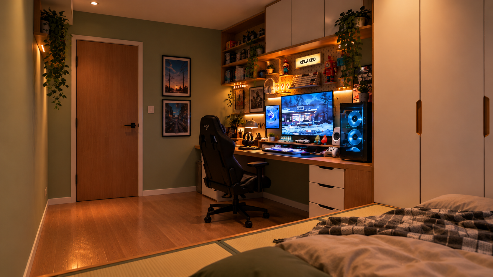

# ENV-BED-001｜卧室场景参考 v01

2026-10-30，用户明确“这张图作为卧室的场景”，已按原始字节登记。此为本项目新增卧室参考，不替换客厅母版或旧平面，未改图或重生成。

图中可见：左侧闭合木门、门旁上下两幅画；电脑桌/黑色椅子/横竖屏及蓝光主机；右侧浅色通顶衣柜；前景床榻及枕被；绿墙、木地板和暖色照明。后续同角度制作应引用此原件，不任意移动这些可见锚点。

采用范围是卧室外观、当前视角家具关系与图中照明参考。窗户、画外床体、房间尺寸、与总平面门洞的对应、具体场次和A/B世界归属尚未指定，不从图中补全。需与正在制作的白模对齐后再安排新机位/人物路线；不擅自将其替换成旧书房设定。

[资产编号、来源、分辨率及SHA-256](asset.json)。原剪贴板文件保留，新入库图没有重编码，未覆盖历史文件。已登记不等于精确几何/最终光影/正式首尾帧通过。
