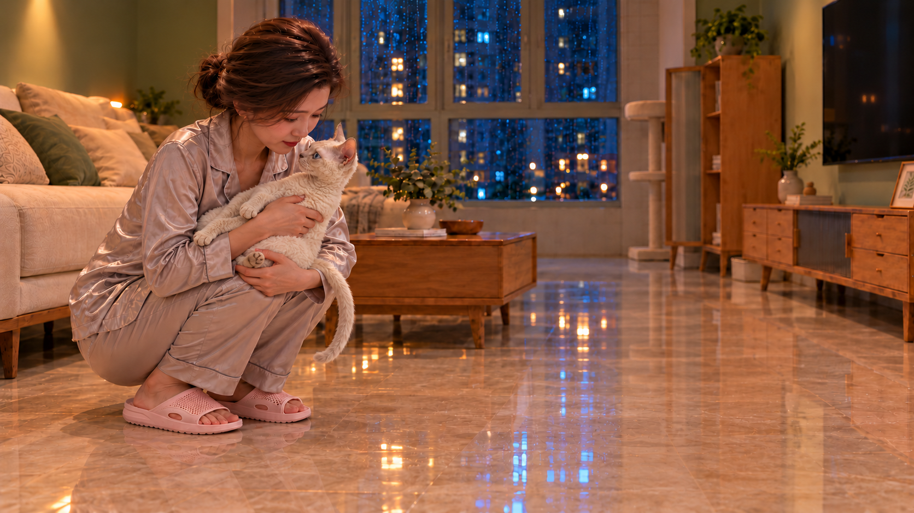

# K05-H0｜蹲姿抱稳候选 v01

2026-10-26，继承用户对[T0 v02](../K05-T0/README.md)五官、猫毛、手鼻关系的认可，制作下一承托状态。**待用户审核，不等于视频完成或动态批准。**

已检查：人物仍蹲着，A粉色拖鞋落地；猫离地且靠近身体；上方手臂环抱胸腹，下方手托后躯。猫姿态较请求的近水平/微斜更竖直，后腿受遮挡，提交用户判断承托是否自然、人猫比例/五官/猫毛是否保持，不据单帧证明完整解剖及动态受力。

实际四张输入与SHA-256见[asset.json](asset.json)，[原始提交提示词](prompt-v01.txt)从原生成工具调用恢复，未用计划提示词冒充实际输入。原生成文件保留，未覆盖旧帧。

通过后才制作H1站稳状态；当前较近画幅不能保证同构图站起不裁头，须先讨论取景或剪辑方案。23:16—23:20中间活动段保留，不因关键帧制作顺序而删除。未生成视频。

## v02｜体型与尾巴修正候选

用户指出v01尾巴不自然、猫显大，v01标记需修改并保留。内置imagegen按原猫身份做局部修正，生成[v02](assets/K05-H0_v02.png)，[实际提示词](prompt-v02.txt)。猫轮廓收小，尾巴较短并弯曲；尾根仍被手/后躯遮挡，尚不能判定自然程度已通过，待用户看图。人物仍蹲，未制作H1或视频。
