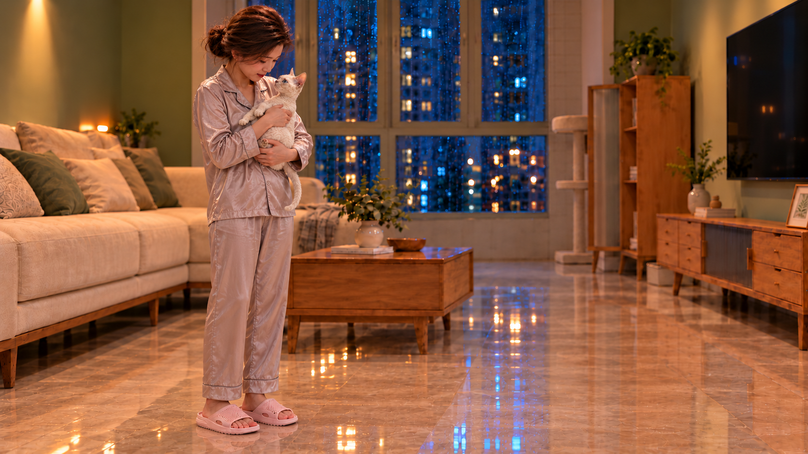

# K05-H1｜抱稳后站定 v01

2026-10-26，按用户要求继续制作流程，先完成站姿结构候选。**本图只供场景、构图和动作审核，不是正式视频首尾帧，光影色调未定稿。**

来源为[H0 v02](../K05-H0/README.md)，人物五官执行参考、正式猫、A粉拖鞋共四张实际输入；[完整实际提示词](prompt-v01.txt)与[哈希/检查记录](asset.json)已保存。内置imagegen生成，原件保留。

可见：妻子直立、完整头脚、双脚落地，胸腹环抱与后躯托举，猫没有落地。需审核：猫相对胸口的尺度是否过小、五官/猫毛/尾巴是否连续、承托是否自然。头顶余量偏紧。取景为容纳站姿的构图候选，与H0背景投影不完全一致，不能称已实现固定机位，也未批准新增推拉摇移或剪辑。

H0 v02获“这张还比较自然”的正向反馈，可作为本轮衔接依据；不扩大为整组摄影批准。H1仍待审核，后续按流程推进，不抢先进入光影制作或视频生成。

## v02｜亲昵接触候选已生成

此前两次生成拦截均保留原始失败记录；本次已实际生成[v02](assets/K05-H1_v02.png)，[实际提示词](prompt-v02.txt)。实际只有v01底图一个输入，未重新绑定独立猫/五官图，不能称多参考生成。可见猫额鼻部与人物下颌附近接触，亲昵状态较v01明确；但纯额头接触、猫颈卷毛及身份连续性仍待审核。静态接触不等于动态蹭动已验证。维持场景/构图/动作验证定位，不是最终摄影首尾帧。

## v03｜重新绑定正式猫外观返修

用户指出v02猫脸变形，并确认返修方案。**v02停止使用，仅保留历史。** 本轮从v01底图重新生成，实际绑定正式bubu-multiview和当前采用五官，共三张输入，见[实际提示词](prompt-v03.txt)及asset.json的actual_inputs_v03。

[v03候选](assets/K05-H1_v03.png)中猫眼鼻口下巴较v02可读，人物低头配合贴靠，双手仍托住胸腹与后躯。尚不能宣称外观锁定成功，须用户检查眼耳比例、口鼻、短卷毛、尾巴及接触；不自动通过。光影定稿与视频未进行。

## v04/v05｜身体被毛返修

用户反馈v03脸较接近但身体毛不一致，本轮两次均实际输入正式猫＋v03底图，分别保存[中文实际提示词](prompt-v04.txt)、[第二次实际提示词（英文原文）](prompt-v05.txt)。v04变化不足，保留过程；[v05候选](assets/K05-H1_v05.png)颈胸卷纹增强，但是否仍过于规则、缺少原资产柔软短卷绒感尚待审核，不宣称已解决。脸、接触、体型亦须复核。未进入视频或正式光影阶段。

## v06｜以毛质工作图回填全身候选

用户否决v05规则卷纹。此次先制作[局部毛质工作图](assets/fur-detail_v06_working.png)，实际输入为正式猫＋v05；再用v05底图＋正式猫＋工作图生成[全身v06](assets/K05-H1_v06.png)。两步均为内置imagegen，提示词分别保存为prompt-v06-detail.txt及prompt-v06.txt。工作图不是新增镜头，也不作为人物/猫脸身份主参考。

v06颈胸腹侧毛束更松散，连续规则条纹有所减少；但是否过蓬、毛束是否偏粗、是否达到原资产短细绒感仍待用户审核。脸、体型与接触须复核，不宣称已完成外观锁定。v05保留为毛质未通过，未进行视频或光影定稿。

## v07｜实际图层合成候选

用户同意后，已使用常规Pillow图层合成，将获认可局部工作图的胸肩/腹侧毛像素缩放贴回v03底图，不经模型重绘。[v07全身](assets/K05-H1_v07.png)、[放大前后对照](composite-v07/before-after.png)、[蒙版/毛层/复现说明及像素验证](composite-v07/README.md)均已保存。保护头脸与双手，蒙版外像素完全不变；已验证实际毛区2439个像素变化。v06标记回填失败，保留历史。

待审：纹理边缘/接缝是否自然，缩回全身后的毛感是否满足要求；手边和颈部保护边缘仍有部分旧毛，不声称所有被毛已完整替换。未生成视频或调整光影。
