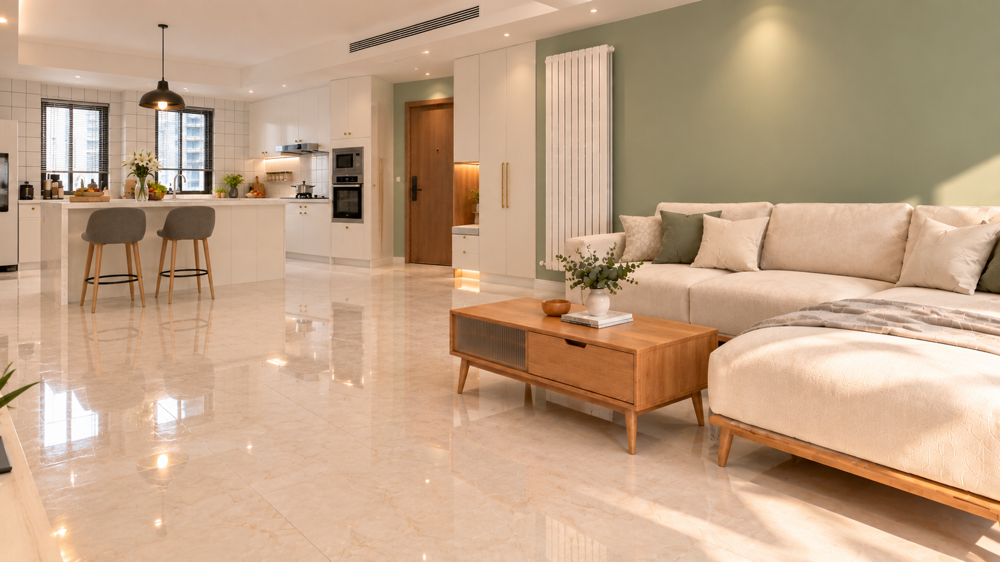

# C61空景 v01｜只核对空间

2026-10-26。按用户明确要求：回到已确认空间母版与动线，先核C61空景，家具/门窗/岛台关系通过后再加人物。此为空间前置检查，不新增正式镜头数。

**状态：待用户空间审核，无人物/猫，非合格机位母版，非正式首尾帧。** 没有输入O0 v01—v05任何错误图。实际5张正式参考、源哈希及生成原文件见[asset.json](asset.json)，[实际提示词](prompt-v01.txt)已保存。正式PLAN-001及VIEW-03哈希与批准记录吻合，原文件未修改。

## 核对依据

| 对象 | 原依据 | v01可见情况 | 待审核内容 |
|---|---|---|---|
| 机位 | PLAN-001＋原C61电视侧点位 | 不强行让电视正面入画，视野含近侧沙发与斜向岛台 | 是否为C61实际观察关系，不能只凭外观认定 |
| 沙发 | VIEW-03新版、PLAN-001 | 奶油L形，近侧右方，薄毯仍在 | 端头/贵妃位位置与透视、占地是否正确 |
| 茶几 | VIEW-03/04 | 木色、竖纹门与抽屉，未换大理石 | 与沙发间距、朝向是否正确 |
| 岛台/椅 | VIEW-02、PLAN-001 | 白岛台、两高脚椅、斜向入画 | 原位置及侧向透视，不以变机位重排家具 |
| 门柜 | VIEW-05 | 木门、白高柜含坐凳凹槽、暖气片与沙发的连接可对照 | 与平面实际落位和遮挡是否一致 |
| 窗与厨房 | VIEW-02 | 双窗、左冰箱局部、右烤箱柜/灶区 | 斜视后连接是否保持，未露全不等于可新增 |
| 地面/新物 | PLAN-001、空间约束 | 无地毯、无独立餐桌，无人物或猫 | 不在核对阶段新增家具 |

**照明说明：** 为看清几何，仅沿空间母版日间工作照明；不是把剧情雨夜改白天，不是电影光影批准。没有重新设计正式夜景。

本图与原参考的精确三维位置/净距尚未标定。当前只提交空间候选，不称“已经锁定C61”。用户审核通过后才能放A/B；否则只修空间，不继续错误构图派生。后续保留A靠沙发G内、B通道G外及A朝B的关系，不能为露正脸改变机位。

参考原图入口：[PLAN-001](../../../assets/space/PLAN-001_彩平图_20261025_阳台家具删除版.png)、[VIEW-05入户门](../../../assets/views/VIEW-05_朝入户门.jpg)、[VIEW-02厨房](../../../assets/views/VIEW-02_朝厨房.jpg)、[VIEW-03沙发](../../../assets/views/VIEW-03_朝沙发.png)、[VIEW-06走廊](../../../assets/views/VIEW-06_朝卫生间.jpg)。
