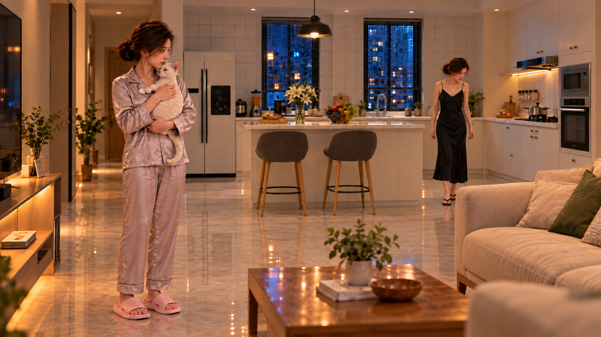

# K06-O0｜双妻子客观关系候选

2026-10-26，承接用户采用的H1 v07，按原生产链进入SC06客观关系帧：C61客厅靠电视一侧斜向餐厨，A在G内抱猫，B在G外餐厨通道寻找且看不到A与猫。此为场景/构图/动作关系验证，非正式首尾帧，不进行最终光影或视频。

v01因B靠沙发、G外位置不清和新增地毯未通过，保留过程。v02将B退到更远餐厨侧并去掉地毯，两女一猫、不同衣装、未互相对视。

必须待核：实际C61轴线，A/B对应G内外地砖位置；B仍在岛台右通道而不是提示词要求的左通行口，不能直接称路线已正确。新角度的两张脸、猫尺度与毛质也待核，不能声称H1通过内容已在新图像素锁定。

[实际输入与SHA-256](asset.json)、[v01实际提示词](prompt-v01.txt)、[v02实际提示词](prompt-v02.txt)已保存。v01实际使用的B补鞋图只参考衣装鞋款，不把其候选脸当身份批准；v02另实际绑定当前五官参考。C61预演已看图用于设计，但未作为本轮图像生成输入，不虚报。

下一项：审核O0后做K06-P0 B真实眼位空镜。C64新增跨界验证另按既有纠错任务先做阳台侧朝客厅的单张空景，不与C61/C62混用。SC05踩毯/茶几活动段仍保留待制作，当前按关键状态链推进不等于删镜。

## v04｜A移近沙发站位候选

用户要求A更靠近沙发，已从v02电视侧位置移到沙发端头外、茶几后方；v03两人重叠过多保留过程，进一步微调为[v04](assets/K06-O0_v04.png)。前景家具自然遮挡部分A腿脚，B保留餐厨侧搜索。实际输入及两次提示词已登记。G边界、两人前后距离/视线、A同H1脚位连续性及新角度猫毛/尺度仍待审核，不因移位成功自动通过整帧。
