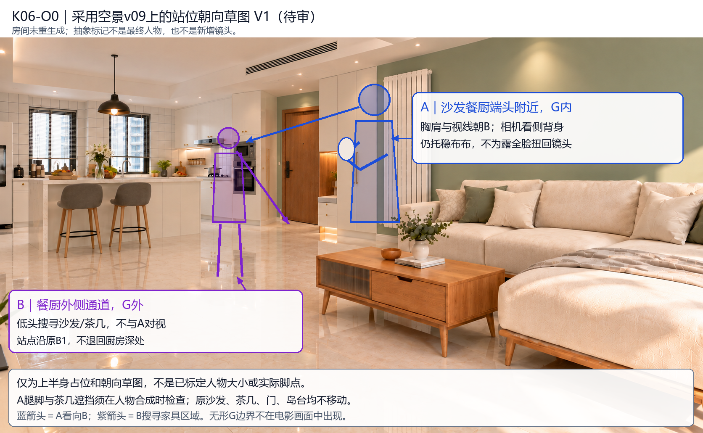

# O0人物站位/朝向覆盖草图 V1

> 2026-10-30同步核对：现行剧本已为V1.6.6b，第389、635、1057行明确A在沙发靠餐厨端头外侧的既定G内站位附近，不挤入狭缝。旧V1.6.5“沙发与茶几之间”已由新版修订，不再列为当前冲突；后续用白模核实际投影和B界外，不重新决定已明确站区。

2026-10-26，承接用户采用的C61-empty v09，只在独立透明层上画抽象占位与视线，不重生成房间，也不重新生成女主或猫。**本图是构图提案，不是已完成的真人关键帧。**

蓝A：原批准平面A点在沙发餐厨端头附近G内；图上只示意上半身画面区域，胸肩/视线向B，相机看侧背，抱稳同一猫。紫B：原B1通道G外，低头扫视家具，不与A对视、不看见猫。A相机投影较近、B较远，不为两人正脸齐露重排家具。

**精度：**使用原批准C61=(535,540)、A=(620,675)、B1=(820,620)作为拓扑依据；屏幕标记为当前空景上的人工构图提案，未完成三维投影，不是实测身高/足点。A腿脚及与茶几的遮挡须在真人层制作时核验；不将标记画在桌面解释成真实脚落在桌上。

[原平面核对图](../C61-blocking-audit_v1.png)、[透明覆盖层](blocking-overlay.png)、[实际底图哈希/标记坐标与限制](blocking.json)。底图哈希与采用记录一致，并已检查覆盖层之外的底图像素完全不变。

本轮请只核对A/B的前后关系、A朝B的方向、B搜寻而无对视的关系。批准这张草图也不等于真人尺寸、脚点、身份/毛质、最终光影或视频通过。核对后才准备人物局部层，房间v09保持；不重开门框返修。

## A位置澄清与白模核对（2026-10-26）

A按原平面位于沙发餐厨端头的外侧空地G内，不在沙发与茶几的狭缝。用户指出B太靠G且难辨界外，现草图不作为G外已验证依据；详见[白模核对要求](C61_白模站位核对要求_V1.md)。用户正在小云雀建白模，尚未取得其数据，不声称已验证。建议先核白模地面G/A/B/C61再做真人层，不继续二维猜站位。
